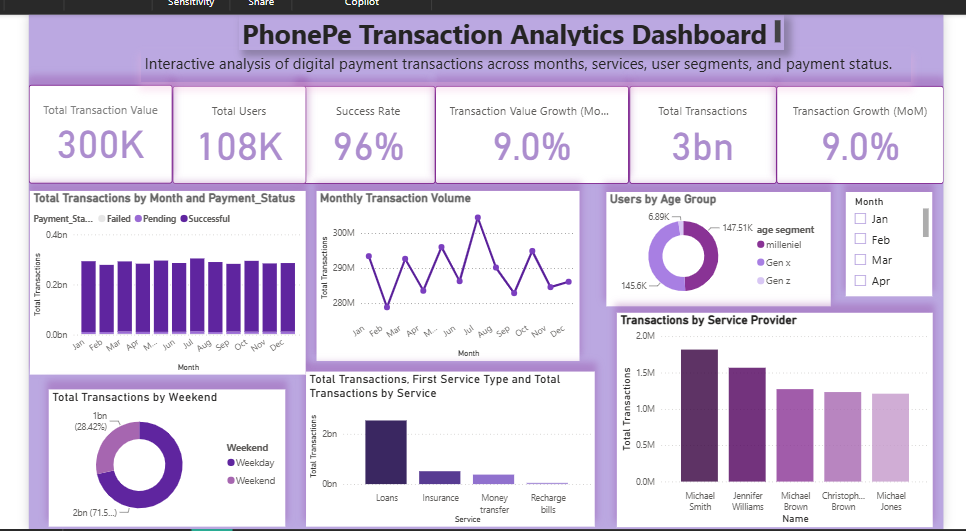

# PhonePe Transaction Analytics Dashboard

Interactive Power BI dashboard analyzing digital payment transactions
across months, services, user segments, and payment status.

📄 [View Dashboard PDF]("C:\Users\PERSONAL\OneDrive\Desktop\PhonePe-Transaction-Analysis-PowerBI\report\PhonePe_Transaction_Analytics_Dashboard_Final.pdf")

## Objective
Understand transaction trends, success rates, and user behavior
to support data-driven decisions.

## Key KPIs
- Total Transaction Value, Total Users, Total Transactions
- Success Rate
- Month-over-Month growth (value and transactions)

## Visuals Included
- Transactions by month and payment status
- Monthly transaction volume trend
- Users by age group
- Weekday vs weekend transactions
- Transactions by service type and service provider
- Month slicer for interactive filtering

## Tools & Skills
Power BI, Power Query, DAX, Data Visualization

## Key Insights
-  Transaction Growth: Month-over-month transaction growth reached 9.0%.
-  Highest Transaction Month: July recorded the highest transaction volume.
-  User Demographics: Millennials represented the largest user segment. 
-  Service Analysis: Loans accounted for the highest transaction volume.
-  ]Transaction Pattern: Weekday transactions were significantly higher than weekend
transactions

## Files
- `PhonePe_Dashboard.pbix`: Power BI file
- `data/`: data used
- `images/`: dashboard screenshot
- `report/`: PDF export

## Author
Tanvi Rode | Data Analyst (Fresher) | Thane, Maharashtra
